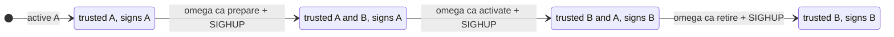

# Rotating the built-in CA

With `--ca-backend=disk`, Omega's CA lives in `<data-dir>/ca`. It can be replaced while the server runs, in three steps that each take effect on `SIGHUP`. The design decision is [ADR 0019](adr/0019-runtime-ca-rotation.md); the runnable demo is [`examples/ca-rotation/`](../examples/ca-rotation/).



## Steps

```bash
omega ca status   --data-dir /var/lib/omega   # what is active, next, previous
omega ca prepare  --data-dir /var/lib/omega
kill -HUP <omega server pid>
# wait until every workload and peer has the new bundle (at least one SVID lifetime)
omega ca activate --data-dir /var/lib/omega
kill -HUP <omega server pid>
# wait until what the old CA signed has expired (24 hours for JWT-SVIDs)
omega ca retire   --data-dir /var/lib/omega
kill -HUP <omega server pid>
```

| Step | Trust bundle and JWKS | Signs with | `spiffe_sequence` |
| --- | --- | --- | --- |
| before | A | A | n |
| prepare | A, B | A | n+1 |
| activate | B, A | B | n+2 |
| retire | B | B | n+3 |

The prepared CA is trusted before it signs, and the previous CA stays trusted after it stops, so a workload or peer that refreshes its bundle between steps never sees a credential from a CA it does not trust. JWT-SVIDs are verified against the key their `kid` names. `omega ca retire` refuses for 24 hours after activation, the longest a JWT-SVID can live; `--force` skips the wait, for a compromised key.

## What to know

Every replica reads its own CA directory, so apply each step on all replicas, then signal them all, before the next step. Each reload that changed the CAs is recorded in the audit chain as `ca.reload`, with the active key id, the number of trusted CAs and `spiffe_sequence`. If a reload fails (a corrupt or mismatched file), the server logs it and keeps the CAs it had. The activation time is recorded in `ca.prev.since`, so the retire guard survives a copy or restore of the directory; a failed reload is recorded too, as `ca.reload` with decision `error` (on a Postgres replica that is not the leader, only in the log). The 24-hour guard covers tokens and SVIDs; a federated peer that refreshes Omega's bundle less often than that needs a longer wait before `retire`. A crash during `activate` is finished the next time the directory is loaded. Only the disk backend rotates this way; Vault PKI, step-ca and Google Cloud CAS rotate in their own systems. With Vault PKI or step-ca, by default a CA the issuer stops publishing is untrusted at the next refresh. With `--upstream-ca-grace` (for example `24h`; never past the CA's own expiry) Omega keeps it in the bundle it serves for that long, so SVIDs it signed keep verifying for peers while workloads are reissued, and `spiffe_sequence` advances. The overlap is opt-in because a kept CA stays trusted even if the issuer withdrew it because it was compromised, until it is distrusted as below. The kept CAs are dropped within one bundle refresh interval of their time, even while the issuer cannot be reached. Omega cannot tell a routine rotation from a revocation, so it logs a warning with the CA's SHA-256 fingerprint when it starts keeping one, and records every change to the kept set in the audit chain as `ca.upstream` (`kept`, or `dropped` with the reason `grace-ended`, `republished` or `distrusted`). If the issuer dropped the CA because it was compromised, add its fingerprint to the file named by `--upstream-ca-distrust` (hex, one per line, `#` comments; `openssl x509 -in ca.pem -outform der | sha256sum` prints it) and send `SIGHUP`: the CA is dropped from the served bundle at once and never kept again, without a restart. Each change to that list, and each list refused as malformed (the previous list then stays in force), is recorded as `ca.upstream` too. An empty file is refused as a likely truncated write; to clear the list, leave only a `#` comment in it. These records are written by the replica that saw the change; on a Postgres replica that is not the leader the append is refused and only the log has it. Without `--upstream-ca-grace` nothing is kept. Only certificates Omega can parse are served. `spiffe_sequence` counts changes within one server process, for every backend: it starts at 1 when the server starts, so a consumer should treat a lower value after a restart or from another replica as a new series, not an older bundle. The kept set is in memory, so replicas that restarted at different times can serve different bundles during the grace period. With those backends the JWT-SVID key is still the local disk key, which `omega ca` rotates as above.
