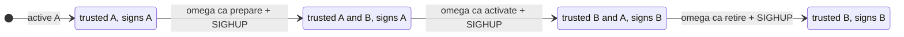

# Rotating the built-in CA

With `--ca-backend=disk`, Omega's CA lives in `<data-dir>/ca`. It can be replaced while the server runs, in three steps that each take effect on `SIGHUP`. The design decision is [ADR 0019](adr/0019-runtime-ca-rotation.md); the runnable demo is [`examples/ca-rotation/`](../examples/ca-rotation/).



## Steps

```bash
omega ca status   --data-dir /var/lib/omega   # what is active, next, previous
omega ca prepare  --data-dir /var/lib/omega
kill -HUP <omega server pid>
# wait until every workload and peer has the new bundle (at least one SVID lifetime)
omega ca activate --data-dir /var/lib/omega
kill -HUP <omega server pid>
# wait until what the old CA signed has expired (24 hours for JWT-SVIDs)
omega ca retire   --data-dir /var/lib/omega
kill -HUP <omega server pid>
```

| Step | Trust bundle and JWKS | Signs with | `spiffe_sequence` |
| --- | --- | --- | --- |
| before | A | A | n |
| prepare | A, B | A | n+1 |
| activate | B, A | B | n+2 |
| retire | B | B | n+3 |

The prepared CA is trusted before it signs, and the previous CA stays trusted after it stops, so a workload or peer that refreshes its bundle between steps never sees a credential from a CA it does not trust. JWT-SVIDs are verified against the key their `kid` names. `omega ca retire` refuses for 24 hours after activation, the longest a JWT-SVID can live; `--force` skips the wait, for a compromised key.

## What to know

Every replica reads its own CA directory, so apply each step on all replicas, then signal them all, before the next step. Each reload that changed the CAs is recorded in the audit chain as `ca.reload`, with the active key id, the number of trusted CAs and `spiffe_sequence`. If a reload fails (a corrupt or mismatched file), the server logs it and keeps the CAs it had. The activation time is recorded in `ca.prev.since`, so the retire guard survives a copy or restore of the directory; a failed reload is recorded too, as `ca.reload` with decision `error` (on a Postgres replica that is not the leader, only in the log). The 24-hour guard covers tokens and SVIDs; a federated peer that refreshes Omega's bundle less often than that needs a longer wait before `retire`. A crash during `activate` is finished the next time the directory is loaded. Only the disk backend rotates this way; Vault PKI, step-ca, AWS Private CA and Google Cloud CAS rotate in their own systems. With Vault PKI, step-ca or AWS Private CA, by default a CA the issuer stops publishing is untrusted at the next refresh. With `--upstream-ca-grace` (for example `24h`; never past the CA's own expiry) Omega keeps it in the bundle it serves for that long, so SVIDs it signed keep verifying for peers while workloads are reissued, and `spiffe_sequence` advances. The overlap is opt-in because a kept CA stays trusted even if the issuer withdrew it because it was compromised, until it is distrusted as below. The kept CAs are dropped within one bundle refresh interval of their time, even while the issuer cannot be reached. Omega cannot tell a routine rotation from a revocation, so it logs a warning with the CA's SHA-256 fingerprint when it starts keeping one, and records every change to the kept set in the audit chain as `ca.upstream` (`kept`, or `dropped` with the reason `grace-ended`, `republished` or `distrusted`). If the issuer dropped the CA because it was compromised, add its fingerprint to the file named by `--upstream-ca-distrust` (hex, one per line, `#` comments; `openssl x509 -in ca.pem -outform der | sha256sum` prints it) and send `SIGHUP`: the CA is dropped from the served bundle at once and never kept again, without a restart. Each change to that list, and each list refused as malformed (the previous list then stays in force), is recorded as `ca.upstream` too. An empty file is refused as a likely truncated write; to clear the list, leave only a `#` comment in it. These records are written by the replica that saw the change; on a Postgres replica that is not the leader the append is refused and only the log has it. Without `--upstream-ca-grace` nothing is kept. Only certificates Omega can parse are served. With `--audit-hmac-key-file`, the kept set is stored in Omega's database (SQLite or Postgres) with each CA's time, together with the CAs the issuer last published, so a restart does not end the grace early, and a CA the issuer stopped publishing while Omega was down is kept from the start and recorded as `kept`. A kept CA whose time ran out while Omega was down is recorded as `dropped` with `grace-ended` at the start. Each kept CA a server takes from the database rather than seeing it leave the issuer (after a restart, or kept first by another replica) is recorded as `kept` with the reason `restored`, so every CA that enters a served bundle this way is on record; only CA certificates are taken, never past their own expiry. A stored row becomes a trust anchor, so each one is MAC'd, together with the time it was written, under the audit HMAC keyring's active key and a row whose MAC does not verify under a key in the keyring is skipped: whoever can write the database but does not hold the key cannot add or extend a trusted CA, and replaying an old valid row grants no more than its write time plus the grace. Without `--audit-hmac-key-file` the kept set stays in memory, as before, and the server warns at start when `--upstream-ca-grace` is set. The distrust list is applied before the stored set is read, so a distrusted CA is never restored. A stored CA is never kept past the time it was first kept plus the current `--upstream-ca-grace`, so a shorter grace applies on a restart, and turning the grace off drops what was kept. With Postgres, every replica reads the shared kept set on each bundle refresh and keeps a CA until the time the leader stored for it, so replicas serve the same bundle; only the leader writes the set. A replica that sees a rotation before the leader keeps the CA on its own until the leader's record arrives. `spiffe_sequence` is stored too, per trust domain, with a digest of the trust anchors and JWT keys it numbered, for every backend and identity source: it advances when they change, never goes back across a restart, and a replica that may not write takes up the leader's number for the same bundle within 30 seconds, numbering a change on its own only until then. The server does not start if it cannot read the stored kept set or sequence, and while the database is unreachable it serves the last sequence until it can read it again. With those backends the JWT-SVID key is still the local disk key, which `omega ca` rotates as above.
