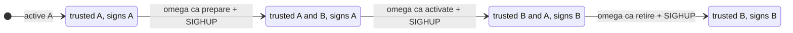

# Rotating the built-in CA

With `--ca-backend=disk`, Omega's CA lives in `<data-dir>/ca`. It can be replaced while the server runs, in three steps that each take effect on `SIGHUP`. The design decision is [ADR 0019](adr/0019-runtime-ca-rotation.md); the runnable demo is [`examples/ca-rotation/`](../examples/ca-rotation/).



## Steps

```bash
omega ca status   --data-dir /var/lib/omega   # what is active, next, previous
omega ca prepare  --data-dir /var/lib/omega
kill -HUP <omega server pid>
# wait until every workload and peer has the new bundle (at least one SVID lifetime)
omega ca activate --data-dir /var/lib/omega
kill -HUP <omega server pid>
# wait until what the old CA signed has expired (24 hours for JWT-SVIDs)
omega ca retire   --data-dir /var/lib/omega
kill -HUP <omega server pid>
```

| Step | Trust bundle and JWKS | Signs with | `spiffe_sequence` |
| --- | --- | --- | --- |
| before | A | A | n |
| prepare | A, B | A | n+1 |
| activate | B, A | B | n+2 |
| retire | B | B | n+3 |

The prepared CA is trusted before it signs, and the previous CA stays trusted after it stops, so a workload or peer that refreshes its bundle between steps never sees a credential from a CA it does not trust. JWT-SVIDs are verified against the key their `kid` names. `omega ca retire` refuses for 24 hours after activation, the longest a JWT-SVID can live; `--force` skips the wait, for a compromised key.

## What to know

Every replica reads its own CA directory, so apply each step on all replicas, then signal them all, before the next step. If a reload fails (a corrupt or mismatched file), the server logs it and keeps the CAs it had. A crash during `activate` is finished the next time the directory is loaded. Only the disk backend rotates this way; Vault PKI and step-ca rotate in their own systems.
