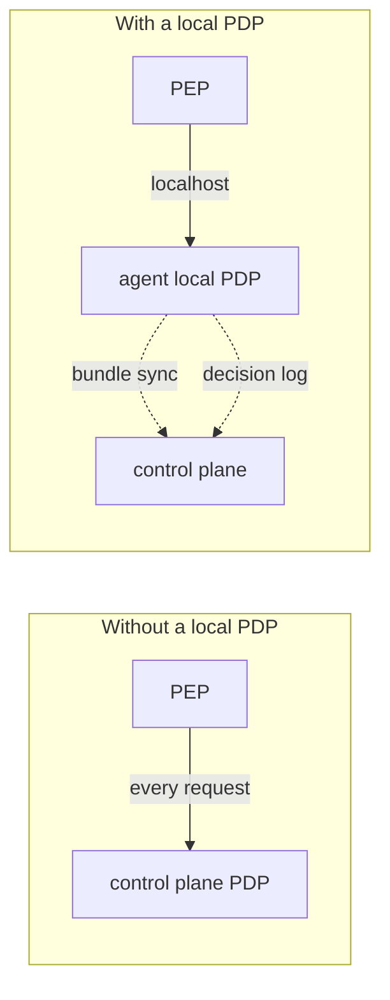
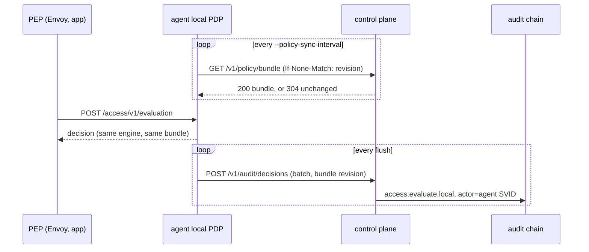
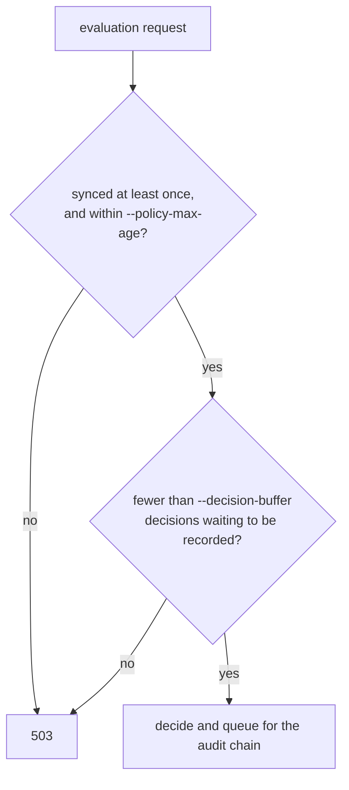

# Local policy decisions

The node agent can decide authorization requests on the node itself, from a copy of the control plane's policy, and still record every decision in the control plane's audit chain. The design decision is [ADR 0016](adr/0016-local-policy-decisions.md); the runnable demo is [`examples/local-pdp/`](../examples/local-pdp/).

## Central decisions vs local decisions



Without it, every decision is a network call to the control plane, so its latency is on every request and an outage stops all decisions. With it, decisions are local, and only the bundle sync and the decision log cross the network, off the request path.

## How it works



The bundle holds the Cedar sources, the static `entities.json`, and the domain and group directory, so a local decision is the one the control plane would make: domain placement, group membership and membership expiry (checked at evaluation time) all behave the same. A bundle whose content does not match its revision is refused.

## When it refuses to decide

The local PDP answers `503` instead of guessing:



| Flag | Default | Meaning |
| --- | --- | --- |
| `--local-pdp-addr` | off | Address to serve `POST /access/v1/evaluation` and `GET /healthz` on, e.g. `127.0.0.1:8181` |
| `--policy-sync-interval` | `10s` | How often the bundle is re-fetched |
| `--policy-max-age` | `1m` | How long the node keeps deciding without a successful sync |
| `--decision-buffer` | `10000` | Decisions that may wait to be recorded before the PDP refuses |
| `--server-ca`, `--client-cert`, `--client-key` | none | TLS to the control plane. The local PDP needs an `https` `--server`, `--server-ca`, and a client certificate (the agent's SVID), re-read when the files change. The SVID's trust domain is the only one the PDP loads a bundle for |
| `--local-pdp-allow-remote` | off | Allow `--local-pdp-addr` to bind a non-loopback address |
| `--map` | none | Optional with `--local-pdp-addr`: without it the agent serves no Workload API and only decides, which is the shape beside a SPIRE agent ([examples/spire-authz](../examples/spire-authz/)) |
| `--policy-bundle-key` | none | The control plane's bundle signing public key; when set, an unsigned, wrongly signed, replayed or stale bundle is refused, and every sync downloads a signed bundle instead of accepting a `304` |
| `--decision-spool` | none | File each decision is written and synced to before it is answered, and requeued from at start, so decisions survive an agent crash |

An evaluation request is capped at 64 KiB (larger ones get `413`), and queued decisions are shipped in batches that stay under the control plane's body limit, so a backlog always drains.

## On the control plane

Reading the bundle and recording local decisions both need `--require-auth`, and the caller must be listed with `--decision-recorder`: a SPIFFE ID, or a prefix ending in `/` such as `spiffe://td/nodes/` for every node agent. Rows land in the audit chain as `access.evaluate.local` with the agent's SPIFFE ID as actor, apart from the server's own `access.evaluate` rows. A refused caller is audited too, and an agent that is refused keeps its decisions queued, so it fails closed once its buffer fills. If an append fails partway through a batch, the control plane reports how many it recorded and the agent resends only the rest; a batch it rejects as malformed (`400`, `413`) is halved until the rejected decision is alone, that one is dropped with an error log, and the control plane records the loss as `access.evaluate.local.dropped`, with the dropped decision ids and a loss id that stays the same across retries, so a gap is visible in the chain and counted once. After three drops in a row the agent stops dropping and fails closed instead: a control plane that rejects everything is a fault, not a bad decision. The endpoint is not idempotent: a batch resent after a lost response is recorded twice, so count local decisions by `decision_id` and losses by `loss_id`. A loss report also carries a SHA-256 of each dropped decision, and the agent drops at most ten per hour before it fails closed. A recorded row is the agent's claim of what it decided; the control plane checks who sent it, not that the policy would have given that answer.

```bash
omega server --require-auth --tls-cert ... --client-ca ... \
  --decision-recorder spiffe://omega.local/nodes/
omega agent --server https://omega:8443 --server-ca ca.pem \
  --client-cert node.pem --client-key node.key \
  --local-pdp-addr 127.0.0.1:8181
```

The local PDP serves `POST /access/v1/evaluation` and `GET /healthz` only; batch evaluation, search and the AuthZEN metadata document stay on the control plane. When it refuses to decide it answers `503` with `Retry-After`, which AuthZEN 1.0 does not define, so treat any non-200 from it as a deny in the PEP.

`GET /healthz` on the local PDP reports the bundle revision, when it last synced, and how many decisions are waiting.

## Changing policy

Edit the files in `--policy-dir` and send `SIGHUP` to every server replica: each one reloads its own copy, and followers serve the bundle too, so until all have reloaded an agent behind a load balancer can see the old and the new revision in turn. In Kubernetes, a rolling restart after the ConfigMap changes does the same. The new revision reaches every node within one sync interval. A file that fails to parse leaves the previous policy in force, on the server and therefore on every node.

## What to know

A node keeps deciding with its last bundle for up to `--policy-max-age` after it loses the control plane, which is the point, but also means a revocation made in that window reaches it late. Local decisions reach the audit chain one flush late. Without `--decision-spool` the queue is in memory, so decisions already answered are lost, with no loss report, if the agent is killed or crashes before a flush; the buffer bound limits how many. With it, each decision is on disk before it is answered (one fsync each) and is requeued at the next start. On a normal shutdown the agent stops its listener and waits for a final flush. With the Helm chart, set `agent.localPDP.enabled`, an https `agent.serverURL` and `agent.localPDP.tlsSecret`, and list the agents in `server.decisionRecorders`. The bundle contains every policy and group membership, so it is served only to authenticated callers under `--require-auth`. Its revision is a content hash: it catches a corrupted bundle. To keep out a forged one independently of TLS, start the server with `--policy-bundle-signing-key` and the agents with `--policy-bundle-key` ([ADR 0018](adr/0018-signed-bundles-and-decision-spool.md)); without them, TLS pinned with `--server-ca` is what does it. The local endpoint itself has no authentication, which is why it stays on loopback by default.
