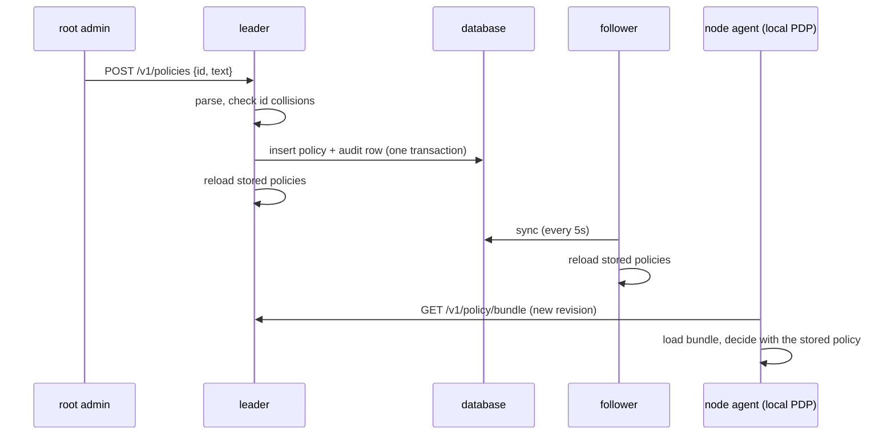

# Stored policies: managing Cedar policies over the API

Cedar policies can come from two places: `*.cedar` files in `--policy-dir`, read at startup and on `SIGHUP`, and policies stored in the control plane's database through `/v1/policies`. The policy engine evaluates the union of both. A stored policy is changed by an authenticated caller, recorded in the audit chain in the same transaction, and reaches every replica and every node agent without a restart. The design decision is [ADR 0022](adr/0022-stored-policies.md).

## Two sources, one policy set

| | `--policy-dir` files | Stored policies |
| --- | --- | --- |
| Where | Files on each server's disk | The database (SQLite or Postgres), shared by replicas |
| Changed by | Whoever edits the files, then `SIGHUP` | A `--domain-root-admin`, through `/v1/policies` |
| Audited | No (keep the tree in version control) | Every change and every refused attempt |
| Over the API | Listed and readable, `source: file`, read-only | Listed, readable and writable, `source: api` |
| Policy ids | `@id("...")`, or `<file stem>::policyN` | Always `api/<id>::<@id or policyN>` |

A stored policy has an id of 1-63 lowercase letters, digits, `-` or `_`, starting and ending with a letter or digit. Its text holds one or more Cedar policies. Every Cedar policy id it defines, an `@id` annotation included, is prefixed with `api/<id>::`, so the `reasons` of a decision name the stored policy that made it, and a stored policy can never take over a policy id a file defines. A file can still define an id that starts with `api/`; the API then refuses a stored policy that would define the same id, and a file reload that would collide with a stored policy is refused and keeps the previous files in force.

There is no Cedar schema in Omega, so validation is syntactic: the text must parse, define at least one policy, be at most 64 KiB, and not collide with a file's policy id. An invalid policy is answered with `400` and never stored.

## Who may do what

| Operation | Needs |
| --- | --- |
| `GET /v1/policies`, `POST /v1/policies/validate` | An authenticated caller under `--require-auth`; open without it. Followers serve them |
| `GET /v1/policies/{id}` (the Cedar text) | Under `--require-auth`, a `--domain-root-admin` or a `--decision-recorder` (which receives every policy in the bundle anyway); open without it. Followers serve it |
| `POST`, `PUT`, `DELETE` on `/v1/policies` | `--require-auth` and a caller listed with `--domain-root-admin`. Leader only |

A Cedar policy is not confined to a domain: a `permit` written by the admin of `media` could name any principal or resource. So the grant a domain admin holds on its subtree does not extend to policies, and only root admins write them. Without `--require-auth` every write is refused with `403`, because the change could not be attributed to anyone. A refused write is audited with the caller and the reason.

## Optimistic concurrency

Each stored policy has a `version` that starts at 1 and grows by one per update, and an ETag `"<version>-<digest>"`, where `digest` is the hex SHA-256 of the text. `GET /v1/policies/{id}`, create and update return it in the `ETag` header.

`PUT` and `DELETE` on `/v1/policies/{id}` need `If-Match` with the current ETag, or `*` to act on whatever version is stored. A missing `If-Match` is answered with `428` and a stale one with `412`, so an admin cannot silently overwrite or delete a version someone else wrote since they read it.

## Audit

Every write and its audit row commit in one database transaction, so a change is never kept without its record. Each time a replica loads the stored set it checks it against the chain: every stored policy's digest must equal the `new_digest` of the latest change the chain records for its id, and every id whose latest change left a policy in place must still be stored. A policy edited, added or removed in the database behind the API therefore does not load (see below). The check holds against a database writer only with `--audit-hmac-key-file`: every chain row it reads must then carry a valid MAC under the keyring, so a writer without the key cannot add a row that vouches for its edit. Without a keyring it does not stop a database writer, who can insert a policy and a matching unkeyed chain row together; it then only catches an edit to the policies table alone, and the server warns at startup under `--require-auth`. Rows deleted from the chain are not caught by the load check; `GET /v1/audit/verify` walks the whole chain for that. The row has the kind `policy.create`, `policy.update` or `policy.delete`, the caller as actor, the policy id as subject, and a payload with the id, `old_digest`, `new_digest` (empty on create and delete respectively), the new `version`, and the Cedar policy ids the text defines. The text itself is not in the row; the digests identify which text was in force, and the API serves the current text.

## Reaching every replica and node



The leader reloads the stored set right after a write. Every replica reloads it with the domain tree every five seconds. The policy bundle served to node agents (`GET /v1/policy/bundle`) carries stored policies under the key `api/<id>` next to the file names, so the bundle revision changes with them and each local PDP picks them up on its next sync.

## When the stored set does not load

The leader only stores a policy that loads, but the stored set can still fail to load on a replica: a row written, changed or removed in the database outside the API (it no longer matches the audit chain), a chain row the check relies on that does not verify under the audit keyring, a replica whose `--policy-dir` defines an id a stored policy also defines, or a server older than the row. Then the replica keeps the last set that loaded in the engine, logs the error, increments `omega_stored_policy_set_load_failures_total`, and fails evaluation closed with `503` at once: the database holds a set the replica is not enforcing, possibly a new `forbid` written through another replica, so deciding with the old set until the usual fifteen-second stale window passed could permit what is now forbidden. A database that cannot be read at all is handled as before, failing closed once the domain tree has not reloaded for fifteen seconds. When the first load at startup fails, the server still starts, with evaluation failing closed, so that an admin can fix or delete the policy through the API. The node agents keep the last bundle they were served, since `GET /v1/policy/bundle` fails closed too. `omega_stored_policies` reports how many stored policies the engine last loaded.

## Walkthrough

```bash
omega policy apply -f block-media-web.cedar --server https://omega:8080 \
  --server-ca ca.pem --client-cert root.pem --client-key root.key
omega policy list --server https://omega:8080 --server-ca ca.pem --client-cert root.pem --client-key root.key
omega policy get block-media-web --server https://omega:8080 --server-ca ca.pem --client-cert root.pem --client-key root.key
omega policy delete block-media-web --server https://omega:8080 --server-ca ca.pem --client-cert root.pem --client-key root.key
```

`omega policy apply` takes the id from the file name (or `--id`), creates the policy when it does not exist, and otherwise updates it with the ETag it just read, so a concurrent change fails with `412` instead of being lost. `omega policy delete` sends `If-Match: *` unless `--if-match` names the ETag to delete.

| Endpoint | Purpose |
| --- | --- |
| `GET /v1/policies` | List stored policies and `--policy-dir` files, without text |
| `GET /v1/policies/{id}` | Show one policy with its text |
| `POST /v1/policies` | Store a new policy |
| `PUT /v1/policies/{id}` | Replace a stored policy's text (`If-Match` required) |
| `DELETE /v1/policies/{id}` | Delete a stored policy (`If-Match` required) |
| `POST /v1/policies/validate` | Run the create checks and change nothing |

`examples/local-pdp` stores a policy with `omega policy apply`, checks that the control plane and the node agent both decide with it, deletes it, and checks both audit rows.
