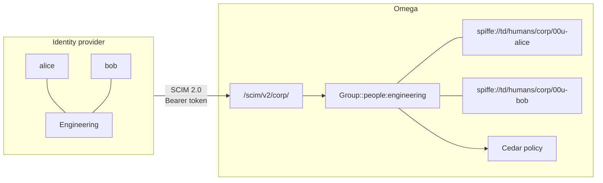
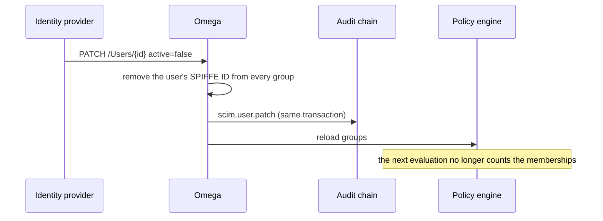

# SCIM provisioning

An identity provider can push its users and groups to Omega over SCIM 2.0 (RFC 7643, RFC 7644). Each pushed group becomes an Omega group, its active members' SPIFFE IDs become the group's members, and Cedar policies on `Group::"<domain>:<name>"` follow the provider's view as it changes. The design decision is [ADR 0017](adr/0017-scim-provisioning.md); groups themselves are described in [groups.md](groups.md), and the runnable demo is [`examples/scim/`](../examples/scim/).

## How it fits



A user's SPIFFE ID comes from the provider's template. The default, `spiffe://<trust-domain>/humans/{idp}/{externalId}`, is the ID the [ID-JAG grant](id-jag.md) gives the same person when the provider's subject is the SCIM `externalId`, so a person signs in and is provisioned under one identity.

## Configure

```bash
openssl rand -hex 32 > /etc/omega/scim-corp.token
chmod 600 /etc/omega/scim-corp.token

omega domain create people
omega server ... \
  --scim-idp name=corp,domain=people,token-file=/etc/omega/scim-corp.token
```

In the provider, set the SCIM base URL to `https://<omega>/scim/v2/corp` and the bearer token to the file's content.

| Key | Meaning |
| --- | --- |
| `name` | The provider's name: the URL segment, the audit actor `scim:<name>` and the `{idp}` placeholder |
| `domain` | The domain the provider's groups are created in; it must exist |
| `token-file` | File holding the bearer token, at least 32 characters |
| `template` | SPIFFE ID template with `{idp}`, `{externalId}` and `{userName}`. It must stay in the local trust domain, start its path with a fixed segment, use `{externalId}` or `{userName}`, and use `{idp}` (ahead of the other two) when more than one provider is configured |

Each value substituted into the template must be exactly one SPIFFE ID path segment (letters, digits, `.`, `-` and `_`), so a user name such as `alice@corp.example` cannot be used with `{userName}`, and a `/` cannot move a user into another part of the tree. Give each provider a domain of its own: it can claim any free group name there, including one a policy already names.

The provider must reach a listener that does not require a client certificate: use `--client-cert-optional` or route `/scim/` through a separate ingress.

## What a provider change does



| Provider action | Effect in Omega |
| --- | --- |
| Create a group | Group `<domain>:<slug of displayName>`, for example `Platform Eng` becomes `people:platform-eng` |
| Rename a group | The Omega group is renamed; policies naming the old name stop matching |
| Add or remove members | The group's SPIFFE ID members change |
| Deactivate or delete a user | The user leaves every group at once; reactivation restores the memberships |
| Change a user's `externalId` | The memberships move to the new SPIFFE ID |

Each change and its audit row are committed in one transaction, so nothing is applied without a record. A group the provider owns can only be changed over SCIM; the Omega group API answers `409` for it.

## Supported SCIM

`Users` and `Groups` support create, read, replace (`PUT`), `PATCH` (`add`, `remove`, `replace`, with or without a path, including `members[value eq "..."]`) and delete, plus `ServiceProviderConfig`, `ResourceTypes` and `Schemas`. Lists accept `filter` of the form `<attribute> eq "<value>"` on `userName` (case-insensitive) and `externalId` for users, `displayName` and `externalId` for groups, and `startIndex` / `count` paging (at most 1000 per page). `excludedAttributes=members` is honoured for groups. Attributes Omega does not keep, such as `name` or `emails`, are accepted and ignored. Bulk, sorting and ETags are not offered. One request may name at most 1000 members and one `PATCH` at most 100 operations (`tooMany` otherwise). Lists and gets do not take the write lock, so a provider's periodic full sync does not hold up other writes.

## What to know

The bearer token is a long-lived secret: keep the file readable only by Omega, and rotate it by replacing the file and restarting. Groups do not nest, so a provider's nested groups are not expanded. Tokens already issued to a user stay valid until they expire, even after deactivation, so keep their lifetimes short where group membership is what grants them.
