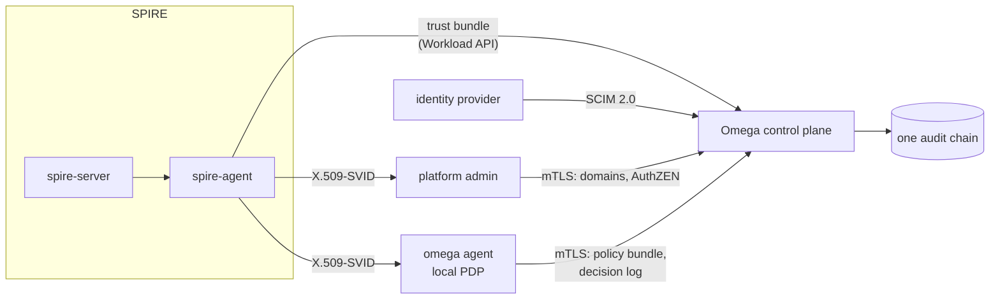

# Authorization and audit for a SPIRE deployment

SPIRE issues workload identities and stops there: what each identity may do is out of its scope. This example keeps SPIRE as the issuer and adds Omega as the authorization and audit layer on top, with real `spire-server` and `spire-agent` images.



What the demo shows, with every identity issued by SPIRE:

| Step | Shows |
| --- | --- |
| Omega starts on SPIRE's trust domain (`--identity-source=spire-upstream`) | Omega issues nothing; it follows SPIRE's trust bundle over the Workload API |
| The platform admin creates domains `payments` and `people`; the node agent tries and gets `403` | Callers authenticate with their SPIRE X.509-SVIDs, and only `--domain-root-admin` may create top-level domains |
| `spiffe://upstream.demo/payments/api` may read the ledger, `.../media/web` may not | Cedar decides by SPIRE path: `principal in Domain::"payments"` |
| The identity provider pushes Alice into "Payments Oncall"; she may approve refunds | People come from the identity provider over SCIM and land in `Group::"people:payments-oncall"` |
| The node agent answers the same questions locally | `omega agent` runs beside the SPIRE agent with no Workload API of its own (no `--map`), authenticated by its SPIRE SVID |
| The identity provider deactivates Alice; both the control plane and the node deny her | Offboarding reaches every decision point within one sync |
| The audit chain holds `domain.create` by the admin, `scim.*` by `scim:corp` and `access.evaluate.local` by the node, and verifies | One trail, attributed to SPIRE identities |

The policy is [`policies/payments.cedar`](policies/payments.cedar).

## Run

```bash
make demo
```

It needs Docker, `curl`, `openssl` and `python3`, and takes a few minutes on a cold image cache. The script tears itself down on exit; `make down` cleans up after an interrupted run.

## What is demo-only

The admin and the node agent get their SVIDs through one SPIRE registration selector (`unix:path` of the SPIRE agent binary that fetches them), so the demo does not show workload attestation keeping the two apart; the `403` for the node agent comes from Omega's admin check. In a deployment each gets its own selector.

The SVIDs for the admin and the node agent are fetched once with `spire-agent api fetch x509 -write`; in a deployment a helper such as `spiffe-helper` keeps them rotated on disk, and Omega re-reads the agent's client certificate when it changes. Omega's own serving certificate comes from a throwaway CA, since in upstream mode Omega issues nothing. The local PDP listens on all interfaces so the host can call it (`--local-pdp-allow-remote`); on a real node it stays on loopback beside the PEP.

See [examples/spire-interop](../spire-interop/) for the identity side alone (Omega following SPIRE's CA and signing-key rotations), [docs/local-pdp.md](../../docs/local-pdp.md) and [docs/scim.md](../../docs/scim.md).
